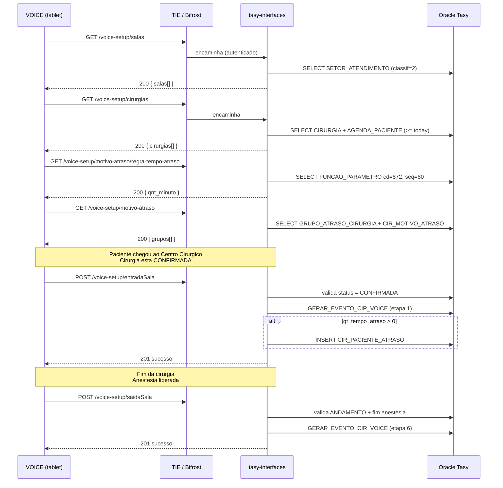

# Voice Setup

Integração entre o **VOICE** (middleware de sala cirúrgica em tablet) e o **Tasy**, permitindo que a equipe cirúrgica:

- Consulte a topologia do Centro Cirúrgico (salas, cirurgias agendadas/em andamento).
- Registre eventos de **entrada** e **saída** do paciente na sala cirúrgica.
- Registre **justificativas de atraso** quando o tempo entre a admissão e a entrada em sala ultrapassa o limite parametrizado no PEPO.
- Consulte a **regra de tolerância de atraso** e os **motivos** cadastrados para exibi-los no tablet.

---

## 1. Arquitetura

```
┌────────┐   HTTPS + Basic Auth   ┌────────────────────┐   HTTP    ┌─────────────────────┐
│ VOICE  │ ─────────────────────► │ TIE / Bifrost      │ ────────► │ tasy-interfaces     │
│ tablet │                        │ (Jetty + Camel)    │           │ VoiceSetupEndpoint  │
└────────┘                        │ voice-setup.bft    │           │ (JAX-RS + JPA)      │
                                  └────────────────────┘           └──────────┬──────────┘
                                                                              │ Oracle
                                                                              ▼
                                                                      Base Tasy (schemas
                                                                      tasy / tasymed)
```

Camadas:

| Camada | Papel | Onde fica |
|--------|-------|-----------|
| Conector Camel/Jetty | Publica endpoint HTTP, aplica Basic Auth + roles, roteia para o backend | [philips-tie-voice-setup.bft](philips-tie-voice-setup.bft) |
| REST layer (JAX-RS) | Recebe request, valida payload, converte exceções em HTTP | [VoiceSetupEndpoint.java](../../tasy-interfaces/voice-setup/src/main/java/com/philips/tasy/integration/voicesetup/rest/VoiceSetupEndpoint.java) |
| Service | Regras de negócio (admissão obrigatória, fim de anestesia, resolução de eventos padrão) | [VoiceSetupService.java](../../tasy-interfaces/voice-setup/src/main/java/com/philips/tasy/integration/voicesetup/service/VoiceSetupService.java) |
| Repository | SQL nativo Oracle contra tabelas Tasy | [repository/](../../tasy-interfaces/voice-setup/src/main/java/com/philips/tasy/integration/voicesetup/repository/) |

Tabelas Tasy tocadas (leitura e/ou escrita):

- `FUNCAO_PARAMETRO` (parâmetro 872/80 — tempo de atraso PEPO)
- `GRUPO_ATRASO_CIRURGIA`, `CIR_MOTIVO_ATRASO`, `CIR_PACIENTE_ATRASO`
- `CIRURGIA`, `AGENDA_PACIENTE`
- `EVENTO_CIRURGIA`, `EVENTO_CIRURGIA_PACIENTE`
- `SETOR_ATENDIMENTO`, `ESTABELECIMENTO`, `UNIDADE_ATENDIMENTO`
- `USUARIO`
- Function PL/SQL: `OBTER_VOICE_SETUP_INT`
- Procedure PL/SQL: `GERAR_EVENTO_CIR_VOICE`

---

## 2. Fluxo funcional



---

## 3. Configuração no TIE

Arquivo do conector: [philips-tie-voice-setup.bft](philips-tie-voice-setup.bft).

### 3.1. Parâmetros do conector

| Config | Obrigatório | Default | Descrição |
|--------|-------------|---------|-----------|
| `protocol` | Sim | `http` | Trocar para `https` em produção (requer `ssl_keystore_name`). |
| `host` | Sim | `0.0.0.0` | Interface de bind do Jetty. |
| `port` | Sim | `9090` | Porta HTTP/HTTPS exposta ao VOICE. |
| `roles` | Não | (vazio) | Role obrigatória para autenticar. Recomendado: `voice-setup`. |
| `ssl_keystore_name` | Não | (vazio) | Nome do keystore registrado no TIE (obrigatório se `protocol=https`). |

### 3.2. Ativar autenticação (Basic Auth + roles)

No `.bft` está publicada uma versão **sem** `requiredRoles` (aberta). Para produção usar a variante segura (também presente no arquivo, comentada):

```xml
<from uri="jetty:${property.configs[protocol]}://${property.configs[host]}:${property.configs[port]}/voice-setup
          ?matchOnUriPrefix=true
          &amp;httpMethodRestrict=GET,POST
          &amp;requiredRoles=${property.configs[roles]}
          &amp;sslContextParameters=${property.configs[ssl_keystore_name]}" />
```

Passos:

1. No console Bifrost/TIE, criar (se não existir) a role **`voice-setup`**.
2. Criar `userCredentials` para o VOICE (ex.: `voice`) com a role `voice-setup`. A senha é definida no console (nunca versionar).
3. Setar a config do conector `roles = voice-setup`.
4. Re-deploy do conector.

### 3.3. Ativar HTTPS

1. Gerar keystore (`.jks` ou `.p12`) com o certificado do servidor TIE.
2. Copiar o keystore para o filesystem do TIE (ex.: `/bifrost/network/voice-setup/keystore.jks`).
3. Registrar no `.bft` (bloco `keystores`) ou pelo console TIE, dando um `name` (ex.: `voice_setup_keystore`).
4. Setar config `protocol = https` e `ssl_keystore_name = voice_setup_keystore`.
5. Re-deploy do conector.

---

## 4. Segurança

| Item | Estado | Observação |
|------|--------|------------|
| Basic Auth via `requiredRoles` | Disponível no `.bft` (comentado) | Ativar antes do go-live. |
| Roles obrigatórias | `voice-setup` | Deve existir no realm Bifrost. |
| TLS (`sslContextParameters`) | Opcional (recomendado) | Obrigatório em produção. |
| Autorização a nível de dados | Herdada da configuração Tasy | Não há filtro adicional por estabelecimento na integração. |
| Sanitização de log | `LogSanitizerUtils` (commons) | Já aplicado no `BaseIntegration`. |
| Injection | Todas as queries usam bind parameters | Nenhuma concatenação de string sensível. |
| Fortify string handling | `FortifyUtils.validaXxx` | Aplicado no mapeamento de `Tuple`. |

Sem `requiredRoles`, qualquer host que alcance a porta do TIE consegue chamar os endpoints — inaceitável em produção.

---

## 5. Endpoints

Prefixo: `{protocol}://{host}:{port}/voice-setup`

Header comum (após ativar segurança):

```
Authorization: Basic base64(voice:senha)
Accept: application/json
```

### 5.1. `GET /motivo-atraso/regra-tempo-atraso`

Retorna a regra de tolerância de atraso (PEPO — parâmetro 80). Se retornar `0`, o VOICE desabilita a tela de justificativa.

**Origem:** `FUNCAO_PARAMETRO (cd_funcao=872, nr_sequencia=80)`.

**Resposta 200:**

```json
{
  "ds_parametro": "Tempo em minutos de atraso para chamar a tela de justificativa de atraso de cirurgia",
  "qnt_minuto": 15
}
```

### 5.2. `GET /motivo-atraso`

Retorna os grupos de motivo de atraso ativos e seus motivos.

**Origem:** `GRUPO_ATRASO_CIRURGIA` ↔ `CIR_MOTIVO_ATRASO`, ambos com `IE_SITUACAO='A'`.

**Resposta 200:**

```json
[
  {
    "nr_seq_grupo_atraso": 1,
    "ds_grupo_atraso": "Paciente",
    "motivos": [
      { "nr_seq_grupo_atraso": 1, "nr_seq_motivo_atraso": 10, "ds_motivo": "Paciente atrasado" },
      { "nr_seq_grupo_atraso": 1, "nr_seq_motivo_atraso": 11, "ds_motivo": "Preparo pendente" }
    ]
  }
]
```

### 5.3. `GET /cirurgias`

Lista cirurgias agendadas a partir de hoje e suas fases (`PREVISTA`, `CONFIRMADA`, `EM ANDAMENTO`, `REALIZADA`).

**Origem:** `CIRURGIA` ↔ `AGENDA_PACIENTE`, filtro `trunc(ap.dt_agenda) >= trunc(sysdate)`.

**Resposta 200 (exemplo):**

```json
[
  {
    "surgery_id": 1234,
    "schedule_id": 9876,
    "patient_name": "MARIA SILVA",
    "patient_birthdate": "1980-05-14T00:00:00Z",
    "patient_uuid": "5567",
    "patient_attendance_id": 4455,
    "surgeon_name": "DR. JOSE",
    "scheduled_at": "09/09/2026 08:30:00",
    "place_name": "SALA 01 - CC",
    "place_uuid": "12-01",
    "procedure": "APENDICECTOMIA",
    "patient_arrived": 1,
    "status": "CONFIRMADA",
    "admission_at": "09/09/2026 08:20:00"
  }
]
```

### 5.4. `GET /salas`

Lista as salas cirúrgicas ativas (`IE_SITUACAO='A'` e `CD_CLASSIF_SETOR=2` — Centro Cirúrgico).

**Origem:** `SETOR_ATENDIMENTO` ↔ `ESTABELECIMENTO` ↔ `UNIDADE_ATENDIMENTO`.

**Resposta 200 (exemplo):**

```json
[
  {
    "cd_estabelecimento": 1,
    "unidade": "HOSPITAL EXEMPLO",
    "cod_setor": 12,
    "setor_unidade": "CENTRO CIRURGICO",
    "cd_unidade_basica": "01",
    "cd_unidade_compl": "A",
    "uid1": "12-01-A",
    "uid2": "1-12-01-A"
  }
]
```

### 5.5. `POST /entradaSala`

Registra a entrada do paciente na sala cirúrgica e, se houver, a justificativa de atraso.

**Pré-condição:** cirurgia deve estar **`CONFIRMADA`** (paciente admitido no Centro Cirúrgico).

**Payload:**

```json
{
  "nr_cirurgia": 1234,
  "nr_matricula": "12345",
  "ds_justificativa": "Paciente chegou atrasado por trânsito.",
  "nr_seq_motivo_atraso": 10,
  "qt_tempo_atraso": 20,
  "nr_seq_evento": null
}
```

| Campo | Tipo | Obrigatório | Observação |
|-------|------|-------------|------------|
| `nr_cirurgia` | long | Sim | `CIRURGIA.NR_CIRURGIA`. |
| `nr_matricula` | string | Sim | Matrícula do profissional (`USUARIO.CD_PESSOA_FISICA`). |
| `ds_justificativa` | string | Não | Texto livre. |
| `nr_seq_motivo_atraso` | long | Não | Presença ativa o registro em `CIR_PACIENTE_ATRASO`. Deve existir em `CIR_MOTIVO_ATRASO`. |
| `qt_tempo_atraso` | long | Não | Minutos de atraso. |
| `nr_seq_evento` | long | Não | Se omitido, o backend resolve o `EVENTO_CIRURGIA` com `IE_ETAPA_CIRURGIA=1`. |

**Resposta 201:**

```json
{ "type": "success", "message": "Evento de 'Entrada do paciente na sala cirúrgica' registrado com sucesso." }
```

Quando há atraso persistido:

```json
{ "type": "success", "message": "Evento de 'Entrada do paciente na sala cirúrgica' e atraso registrados com sucesso." }
```

**Erros 400 (`{ "type": "error", "message": ... }`):**

- `Pendente admissao no Centro Cirurgico` — cirurgia não está `CONFIRMADA`.
- `Evento de entrada em sala nao configurado no Tasy.` — não existe `EVENTO_CIRURGIA` com `IE_ETAPA_CIRURGIA=1`.
- `Usuario nao encontrado para a matricula informada.`
- `Motivo de atraso invalido ou nao cadastrado.`
- `nr_cirurgia obrigatorio.` / `nr_matricula obrigatorio.` / `Payload obrigatorio.`
- `Evento da cirurgia nao localizado apos insercao.`

### 5.6. `POST /saidaSala`

Registra a saída do paciente da sala cirúrgica.

**Pré-condições:**

1. Cirurgia deve estar **`EM ANDAMENTO`**.
2. Evento **Fim da Anestesia** deve estar cadastrado e liberado em Tasy.

**Payload:**

```json
{
  "nr_cirurgia": 1234,
  "nr_matricula": "12345",
  "nr_seq_evento": null
}
```

| Campo | Tipo | Obrigatório | Observação |
|-------|------|-------------|------------|
| `nr_cirurgia` | long | Sim | |
| `nr_matricula` | string | Sim | |
| `nr_seq_evento` | long | Não | Se omitido, o backend resolve o `EVENTO_CIRURGIA` com `IE_FINALIZA_CIRURGIA='S'` (equivalente a `IE_ETAPA_CIRURGIA=6`). |

**Resposta 201:**

```json
{ "type": "success", "message": "Evento de 'Saída do paciente da sala cirúrgica' registrado com sucesso." }
```

**Erros 400:**

- `Cirurgia nao iniciada (paciente nao admitido em sala).`
- `Fim de Anestesia nao cadastrada/liberada.`
- `Evento de saida da sala nao configurado no Tasy.`

---

## 6. Códigos HTTP

| Código | Quando |
|--------|--------|
| **200** | GETs bem-sucedidos. |
| **201** | POSTs bem-sucedidos (evento registrado). |
| **400** | Regra de negócio violada (`VoiceSetupBusinessException`) ou payload inválido. |
| **401** | Sem `Authorization` ou credencial inválida (Jetty/Bifrost). |
| **403** | Autenticado mas sem a role `voice-setup`. |
| **422** | Erro `ORA-20011` (pck_abort) originário de trigger Tasy. |
| **500** | Erro inesperado (JDBC, mapper, transação). |

---

## 7. Testes no Postman

### 7.1. Environment

| Variable | Value | Type |
|----------|-------|------|
| `tie_host` | `http://bifrostdev.whebdc.com.br:9021` | default |
| `tie_user` | `voice` | default |
| `tie_pass` | (senha do usuário `voice`) | **secret** |

### 7.2. Collection

- Aba **Authorization** da Collection → **Basic Auth**, `{{tie_user}}` / `{{tie_pass}}`.
- Requests → aba Authorization → **Inherit auth from parent**.

### 7.3. Requests sugeridos

| Nome | Método | URL |
|------|--------|-----|
| Regra tempo atraso | GET | `{{tie_host}}/voice-setup/motivo-atraso/regra-tempo-atraso` |
| Motivos de atraso | GET | `{{tie_host}}/voice-setup/motivo-atraso` |
| Cirurgias | GET | `{{tie_host}}/voice-setup/cirurgias` |
| Salas | GET | `{{tie_host}}/voice-setup/salas` |
| Entrada em sala | POST | `{{tie_host}}/voice-setup/entradaSala` |
| Saída da sala | POST | `{{tie_host}}/voice-setup/saidaSala` |

### 7.4. Validação da segurança

| Cenário | Esperado |
|---------|----------|
| Sem header `Authorization` | 401 `WWW-Authenticate: Basic ...` |
| Credencial inválida | 401 |
| Usuário sem a role `voice-setup` | 401/403 |
| Credencial correta com role | 200/201 |

Se o 401 **não** aparece sem credencial, o `<from>` com `requiredRoles` **não** está ativo — revisar o `.bft` no TIE.

---

## 8. Checklist de deploy

- [ ] Objetos PL/SQL publicados: `OBTER_VOICE_SETUP_INT`, `GERAR_EVENTO_CIR_VOICE`.
- [ ] Parâmetro PEPO 80 (`FUNCAO_PARAMETRO 872/80`) preenchido conforme regra de negócio do cliente (0 desabilita justificativa).
- [ ] `EVENTO_CIRURGIA` com `IE_ETAPA_CIRURGIA=1` (entrada) e `IE_FINALIZA_CIRURGIA='S'` (saída) cadastrados e ativos.
- [ ] Motivos de atraso (`CIR_MOTIVO_ATRASO`) e grupos (`GRUPO_ATRASO_CIRURGIA`) cadastrados.
- [ ] Usuários operadores do VOICE com `USUARIO.CD_PESSOA_FISICA` válido (matrícula usada em `nr_matricula`).
- [ ] Módulo `voice-setup` do `tasy-interfaces` publicado no `tie-layer`.
- [ ] Conector `philips-tie-voice-setup.bft` importado no Bifrost.
- [ ] Config do conector preenchida (`protocol`, `host`, `port`, `roles`, `ssl_keystore_name`).
- [ ] Role `voice-setup` criada no Bifrost.
- [ ] `userCredentials` do VOICE criado com a role `voice-setup` e senha definida.
- [ ] `<from>` com `requiredRoles` habilitado no `.bft` de produção.
- [ ] Keystore TLS registrado (`sslContextParameters`) — produção.
- [ ] Coleção Postman validada em DEV.
- [ ] Credenciais entregues ao time do VOICE em canal seguro (não versionar).

---

## 9. Estrutura de arquivos

```
tie-integrations/voice-setup/
└── philips-tie-voice-setup.bft        ← conector Camel/Jetty (TIE)

tasy-interfaces/voice-setup/
├── build.gradle
└── src/main/java/com/philips/tasy/integration/voicesetup/
    ├── rest/VoiceSetupEndpoint.java   ← JAX-RS (@Path("/voice-setup"))
    ├── service/VoiceSetupService.java ← regras de negócio + @Transactional
    ├── repository/
    │   ├── DelayConfigurationRepository.java
    │   ├── SurgeryRepository.java
    │   ├── SurgicalRoomRepository.java
    │   └── SurgeryEventRepository.java
    ├── dto/
    │   ├── RoomEntryRequestDTO.java
    │   ├── RoomExitRequestDTO.java
    │   ├── SurgeryResponseDTO.java
    │   ├── SurgicalRoomResponseDTO.java
    │   ├── DelayReasonGroupResponseDTO.java
    │   ├── DelayReasonResponseDTO.java
    │   └── DelayTimeRuleResponseDTO.java
    └── exception/VoiceSetupBusinessException.java
```

---

## 10. Referências

- [philips-tie-voice-setup.bft](philips-tie-voice-setup.bft) — conector Camel/Jetty
- [VoiceSetupEndpoint.java](../../tasy-interfaces/voice-setup/src/main/java/com/philips/tasy/integration/voicesetup/rest/VoiceSetupEndpoint.java) — camada REST
- [VoiceSetupService.java](../../tasy-interfaces/voice-setup/src/main/java/com/philips/tasy/integration/voicesetup/service/VoiceSetupService.java) — regras de negócio
- [BaseIntegration.java](../../tasy-interfaces/commons/src/main/java/com/philips/tasy/integration/commons/defaultobjects/integration/BaseIntegration.java) — tratamento padrão de exceções
